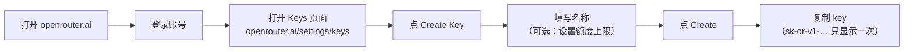
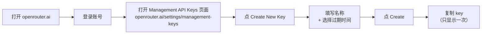

# OpenRouter 两个 Key 说明

> 面向使用者的帮助文档。TokenHamster 的 OpenRouter 数据源会用到**两个 Key**，
> 本文只讲两件事：**它们分别有什么用**、**怎么获取**。

---

## 1. 两个 Key 分别有什么用

| | 普通 API Key | Management API Key |
|---|---|---|
| 英文名 | API Key / inference key | Management API Key |
| 长相 | `sk-or-v1-…` | `sk-or-v1-…`（格式相同，看不出区别） |
| 能做什么 | 调用模型（推理）、查**自己这把 key** 的余额 | 管理账户：查**整个账户**的用量、余额、key 列表等 |
| 不能做什么 | 查不到按模型的用量 | **不能**用来调用模型（只能做管理操作） |
| 在 TokenHamster 里 | **必填**。只填它 → 显示余额（`$xx.xx left`） | **可选**。填了它 → 显示**按模型**的用量明细 |

一句话：

- **普通 API Key** = 花钱的口，也是识别「要统计哪把 key」的凭据。
- **Management API Key** = 管账的口，用来读出**按模型**的用量（官方只允许管理 key 查这些数据）。

> 所以：**只填普通 key** → 只能看余额；**再补上 Management Key** → 才能看到按模型的用量（最近 30 天）。
> 两个 Key 都填在「添加数据源 → OpenRouter」表单里；Management Key 那一栏留空即表示不需要。

---

## 2. 怎么获取

### 2.1 普通 API Key

点击流程：**打开 OpenRouter 官网 → 登录 → 进入 Keys 页面 → Create Key → 命名（可选设额度）→ 复制**

- Keys 页面直链：<https://openrouter.ai/settings/keys>
- 建议给每把 key 设一个**额度上限**，避免泄露后被盗刷。
- 复制后粘贴到 TokenHamster 的 **API Key** 栏。

### 2.2 Management API Key

点击流程：**打开 OpenRouter 官网 → 登录 → 进入 Management API Keys 页面 → Create New Key → 命名 + 选过期时间 → 复制**

- Management API Keys 页面直链：<https://openrouter.ai/settings/management-keys>
- 复制后粘贴到 TokenHamster 表单里的 **Management Key (optional)** 栏。
- ⚠️ 注意：
  - **只能看到一次**，关掉页面就再也看不到，必须当场复制保存。
  - **过期时间在创建后无法修改**，到期后所有请求会失败（`API key expired`），需要新建一把。
  - 权限较大（可管理账户里的其它 key），建议设一个合理的过期时间，并妥善保管。
  - 组织账户只有 **Org Admin** 能创建 Management Key。
